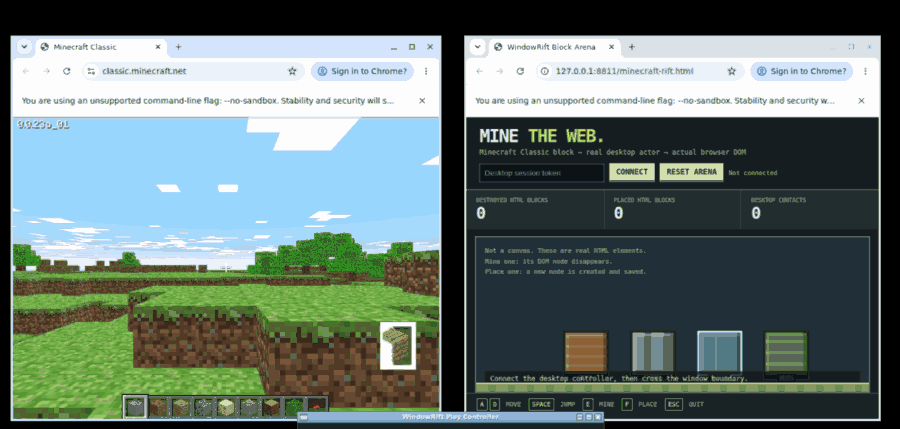
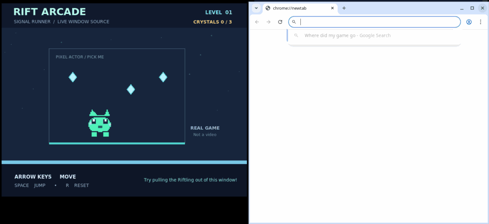

# WindowRift

> **Native object portals across application boundaries, not just cutout images.**

**Status: v0.11.0 experimental.** A capability-first, opt-in adapter interface
connects game-owned object state to a desktop representation and back. Real
Minecraft Java 1.21.1 blocks preserve original block state in a world vault.
Tagged living mobs retain their **original native entity UUID** in a
separate server-side stasis vault while a draggable Qt representation appears
above other application windows. Their gameplay AI remains in Minecraft,
paused while outside the visible map.

This is **not yet a universal solution for arbitrary executables**. Apps
without supported state access still have the legacy visual-only cutout demo.
The actual Minecraft graphical client is **not** launched by the server-side
proof: don't mistake headless-game-server + desktop UI screenshots for
seamless visual extraction from a real playable game window.

- [Stateful application adapter specification](docs/PORTAL_ADAPTERS.md)
- [Native same-UUID Minecraft mob handoff](docs/MINECRAFT_MOBS.md)
- [Existing stateful Minecraft block handoff](docs/MINECRAFT_REAL_STATE.md)
- Native commands: \`windowrift-portal adapters\` and \`windowrift-mob\`
- Proof workflows: [native Minecraft mob](.github/workflows/real-mob.yml),
  [native Minecraft blocks](.github/workflows/real-minecraft.yml)

## Legacy visual-only demos


## Experimental: real Minecraft Java world → desktop → world

**This is a separate, state-backed adapter.** It moves an *actual Minecraft
Java Edition 1.21.1 world block*, not a cutout PNG. WindowRift uses an
authenticated **loopback RCON connection** to an independently owned local
vanilla server. It copies the block, with its original block-state properties,
to an empty reserved in-world vault and clears its source. A native desktop
widget represents the same tracked ID. On return, Minecraft restores the
saved game block from that vault at the chosen destination, then clears the
vault. The original identity survives another pickup/return cycle.

**Do not mistake the GIF above for the new world's integration proof:** it is
a legacy Minecraft Classic visual overlay. The **new** actual-world experiment
is verified separately by
[real Minecraft server handoff CI](.github/workflows/real-minecraft.yml).
That workflow uses an official ephemeral Mojang server, checks the game data
hash, and tests that an east-facing stair actually disappears and reappears
with the same block orientation. It does not distribute Minecraft files.

To run the actual game-backed version, connect your Minecraft Java Edition
client to your **own local vanilla 1.21.1 RCON-enabled server** (not an
unmodified single-player instance), then:

```bash
# Set a private RCON password using a shell prompt, not a CLI argument.
read -rs -p 'Local RCON password: ' WINDOWRIFT_RCON_PASSWORD; echo
export WINDOWRIFT_RCON_PASSWORD

# Set up a real test block in the Minecraft world first (Creative mode):
# /setblock 10 70 10 minecraft:oak_stairs[facing=east,half=bottom]
windowrift-mc take --at 10,70,10 --material minecraft:oak_stairs

# Optional: read real block textures from your owned client jar.
windowrift-real --game-jar "$HOME/.minecraft/versions/1.21.1/1.21.1.jar"

# Returning a block actually changes the Minecraft world:
windowrift-mc list
windowrift-mc put YOUR_OBJECT_UUID --at 14,70,10
```

Back up your test world first. Only basic whitelisted blocks are
supported. Desktop physics and arbitrary game engines are **not** implemented;
the out-of-window object is an interactive native visualization backed by
real game state. **No unsupported images or textures are embedded.**
See the [real-state setup, permissions and recovery guide](docs/MINECRAFT_REAL_STATE.md).

---


**Make a game character walk out of its window and across Chrome's actual address bar.**

WindowRift captures an object from a visible application and renders it in an independent transparent desktop window. You can drag it, enable live pixels, or send it across the real Chrome/Chromium omnibox. The native overlay is shaped and leaves the browser keyboard/mouse input usable; no fake browser window or screenshot compositing is required.

**Scope:** for arbitrary applications this is a visual overlay, *not* a transfer of executable game objects or state. The bundled playable Rift Arcade has a small opt-in localhost adapter that also hides its original sprite during the demo and restores it afterward. Other games remain unchanged. Chrome's browser-owned address bar cannot be modified through web-page DOM APIs.

## Direct play: keyboard-controlled, not an automatic animation

Capture an object in \`windowrift\` and choose **Take control of latest actor**.
Movement now follows real keyboard input and platform physics; the old timed
Chrome cinematic remains optional and separate.

| Keys | Action |
| --- | --- |
| \`A\` / \`D\` or \`←\` / \`→\` | Steer left and right |
| \`Space\`, \`W\`, \`↑\` | Jump from a window or Chrome address-bar ledge |
| Hold \`Shift\` | Sprint |
| \`S\` + \`Space\` or \`↓\` + \`Space\` | Drop down through a ledge |
| \`Esc\` | Exit manual play mode |

Only the focused WindowRift control panel receives gameplay keys. This is
**not a global keylogger**, and ordinary typing in Chrome stays unaffected.
For arbitrary programs the extracted actor is still an OS-level visual
overlay, not a modification of the game process or an export of its live AI.

## Minecraft Classic: mine and build real browser elements



*Real desktop recording from the verified Minecraft integration test; the recording is cropped and palette-reduced for README playback. CI sends OS keyboard events to the same playable controller used by people. [Full-resolution capture and evidence](https://github.com/dbwls99706/windowrift/actions/runs/38832879394).*


Take a visible block from the **official Minecraft Classic game running in Chrome**, then play it across the desktop with A/D, Space and Shift. In the separately opened [Block Arena](examples/minecraft-rift.html), **E removes actual HTML blocks** and **F creates new DOM blocks** textured with the captured game pixels. Reloading the page preserves mined and built blocks.

This is **keyboard-controlled**, not a timed animation; the browser changes its actual DOM rather than only counting collisions. The original Minecraft world is **read-only** and the browser arena is an explicit local opt-in. [Setup and verification guide](docs/MINECRAFT_PLAY.md) · [Automated real-game keyboard test](.github/workflows/minecraft-play.yml).

## New: Minecraft blocks anywhere on the actual desktop


**Real, independently verified desktop recording:** official Minecraft Classic on the left, an unrelated live Wikipedia article on the right, actual X11 mouse building and mining, followed by changing that browser to example.com without moving the blocks. The websites were not modified. [Wikipedia screenshot](docs/media/minecraft-anywhere-wikipedia.png) · [Example.com screenshot](docs/media/minecraft-anywhere-example-com.png) · [Successful source/website verification](https://github.com/dbwls99706/windowrift/actions/runs/38836891816).

**Build on an unrelated website, on Chrome's own address bar, or on empty desktop space.** Open the [official Minecraft Classic](https://classic.minecraft.net/) in one Chrome window and any normal website (Wikipedia, GitHub, anything) in another. WindowRift samples *actual Minecraft hotbar pixels* and draws blocks in an independent **native OS layer**, not inside the website's DOM.

Hold the **left mouse button** to paint a bridge across windows, use **right-click** to mine, **1–8** to switch materials, **Z/Y** to undo/redo, and **Esc** to release the mouse back to the browser. The placed blocks stay visible when the web page changes and persist as desktop screen coordinates.

```bash
# Linux X11, live Minecraft Classic game at 100% browser scaling
sudo apt install python3-tk wmctrl x11-utils
pip install -e .
python examples/minecraft_desktop_builder.py
```

[Desktop building tutorial, limitations and actual-game proof](docs/MINECRAFT_DESKTOP.md) · [UNDERTALE official demo: visual actor escape scope](docs/UNDERTALE_ESCAPE.md)

**Important:** these are OS-level visual Minecraft blocks, not edits to the game's internal world, and the website does not gain new HTML elements. The pointer is intercepted only while explicit Build Mode is active.

## Chrome omnibox: recorded from actual running windows



[Full desktop screenshot](docs/media/chrome-omnibox-actual.png) · [Cropped screenshot](docs/media/chrome-omnibox-cropped.png)

These frames were recorded from **Xvfb + Openbox, an active Tk game, and a real Chromium window** on 2026-10-15. The address/search bar and its suggestion dropdown belong to Chromium. Only the cutout sprite belongs to the separate WindowRift window. The screenshot is not generated, composited, or a mocked Chrome page; the GIF is a sequence of captured desktop frames (cropped/scaled to keep it small).

The native Chrome toolbar portal works as follows:

1. Capture a foreground cutout from the source window.
2. Fly an always-on-top, input-transparent actor across the desktop into the browser's actual omnibox area.
3. Follow the browser's window position while the actor moves inside the address bar; Chrome's normal search input stays functional.
4. **Bundled game only, optional:** a localhost handoff message hides the game's original sprite while it is outside, and a short lease restores it automatically if the demo dies.

### Reproduce the native Chrome search-bar demo on Linux X11

Install the project first (see Quick start), and have a normal Chrome or Chromium window open. Two terminals should share the same ephemeral demo token:

```bash
# In each terminal, set the same temporary token (example value is not private).
export WINDOWRIFT_DEMO_TOKEN='change-this-local-demo-token'

# Terminal 1: a real, playable source game with opt-in visibility handoff
python examples/rift_arcade.py --demo-handoff

# Terminal 2: Chrome must already be open. The demo captures live pixels and
# puts the actor above the *real* browser address/search widget.
python examples/chrome_omnibox_demo.py --duration 0
```

Without `WINDOWRIFT_DEMO_TOKEN`, you can run the same overlay without changing the original game. When multiple browser windows exist, select one with `--browser-id 0x...` (get IDs from `wmctrl -l`). `--crop x,y,w,h` picks another source object, and `--source-title` chooses a different application. The defaults select the small Rift Arcade character. For different Chrome toolbar layouts, adjust `--left`, `--top`, `--right` and `--height`; positions are calibrated estimates, not Chrome internal widget bounds.

For a more general workflow, use the WindowRift Qt panel, extract any visible object, select the Chrome window and click **Into address bar**. **Release from Chrome** returns the actor to desktop physics. This mode is supported on Windows and Linux X11 in code, but the actual omnibox proof here was recorded on Linux X11. The optional game handoff is provided only by Rift Arcade and is not available for other games.

## Actual X11 demonstration


**Reproduced on 2026-10-15 with Xvfb, Openbox, Chromium, Python Tk and WindowRift's
GrabCut/color-key extraction and WebSocket bridge.** This is an authentic cropped
desktop screenshot, not an illustration or image composite. Because this test
environment lacked PySide6, the actor was drawn by the included
[`examples/x11_proof.py`](examples/x11_proof.py) Tk/XShape integration harness,
not by the production Qt control panel. The original game character remains
in the running game; no game-memory modifications are claimed.


### Real commercial-game test: original DOOM shareware

[**Runbook and provenance**](docs/DOOM_SHAREWARE.md). A separate GitHub Actions
workflow runs **Chocolate Doom with the unmodified id Software Doom 1.9
shareware game data**, and launches an independent Chrome window on X11.
It decodes the genuine `TROOA1` sprite patch from the caller-supplied (or
CI-downloaded) WAD and displays that sprite as an input-transparent native
window over Chrome's real address bar. The archive is checksum-checked at
runtime, and **is not committed, bundled or uploaded as an artifact**.


Screenshot from [verified game integration CI](https://github.com/dbwls99706/windowrift/actions/runs/38692731397),
not a drawing or a reconstruction. The original DOOM engine was actually
running; the displayed Imp is a WAD-sourced independent overlay, not a
removed in-world enemy. A later [**verified real desktop recording**](https://github.com/dbwls99706/windowrift/actions/runs/38693889712)
captured **35 consecutive X11 frames** of Chocolate Doom and the Chrome portal.
Open its downloadable `doom-shareware-chrome-x11` artifact to view the
`doom-chrome.gif` recording (artifact retention: seven days). The recording
is authentic screen capture, not a composited or AI-rendered reconstruction.

This is a **read-only asset-assisted demonstration with a real commercial-game
engine**. It is *not* generic game-state extraction, live Imp tracking,
Minecraft modding, or a claim that Doom's in-world actor was removed. The
workflow publishes a time-limited screenshot and proof manifest only when
it completes successfully. Do not describe a scheduled or failed CI run
as a completed commercial-game experiment.

## Features

| Feature | Behavior |
| --- | --- |
| Window capture | Choose a visible window on Windows or Linux X11 and draw a source rectangle. |
| Foreground extraction | Local OpenCV GrabCut, fast flat-background color key for pixel art, optional CPU-based AI (`rembg`), or an unmasked rectangle. |
| Desktop actors | Independent transparent windows with dragging, gravity, screen-edge bouncing, and landing on other window tops. |
| **Live pixels (experimental)** | Refresh pixels using the original foreground mask; optional bounded template tracking follows a moving object within its visible source window (72 px per sample). This does not read game state. |
| **Chrome address bar visual portal** | Independent click-through actor over the real browser toolbar; the source game is not modified, except the opt-in Rift Arcade demo adapter. |
| Browser DOM bridge | Per-tab Chrome extension for webpages, or a direct token-based connection from the included local collision lab. Opted-in targets receive real `windowrift:impact` events. |
| Local only | No screenshot uploads or external inference API. The bridge listens on `127.0.0.1` and requires a random token generated each run. |

## Quick start

**Requirements:** Python 3.10+, Windows 10/11 or **Linux X11**. Wayland and macOS are not supported in this prototype. The default OpenCV mode works without a downloaded AI model.

```bash
# Linux X11 only; either utility works (xprop/xwininfo is a fallback)
sudo apt install wmctrl

python -m venv .venv
source .venv/bin/activate  # Windows: .venv\Scripts\activate
python -m pip install --upgrade pip
python -m pip install -e .
windowrift
```

For optional AI foreground removal, run `python -m pip install -e '.[ai]'`. The `rembg` model is downloaded on its first use and can be large. Model segmentation may be inaccurate on game sprites; try GrabCut with background margin as an alternative.

### Pull an object out of a window

1. Open a game, animation or drawing in a **visible, unobstructed window**. Games using protected fullscreen or exclusive rendering may not be capturable.
2. Launch `windowrift`, choose the source window, and select an extraction method.
3. Optionally enable **Live pixels** to refresh the sprite about eight times per second. Enable **Track motion** to search a 72 px neighborhood for the same foreground inside its original window. The alpha mask is still fixed; fast movement, animation changes or occlusion can cause the tracker to freeze its last good frame. Keep selections at most 512 × 512 pixels.
4. Click **Capture window**, drag a box around the object, and confirm. Include some background margin when using GrabCut.
5. Drag the new actor **away from its original source region** so it does not occlude subsequent captures. The actor falls under gravity and lands on window edges. Right-double-click to remove it.

Live pixels works best with objects that retain their appearance. Tracking is deliberately bounded, and a low-confidence match freezes the last good frame rather than silently switching objects. It does not reconstruct occluded frames, infer unseen body parts, or transfer animation/game state. If other windows obscure the source, visible-pixel capture can be stale; WindowRift detects its own overlays but not every external occluder.

### Run a real playable game

The repository includes a small **Rift Arcade** game. It is intentionally a
real window with keyboard controls (arrow keys to move, space to jump, R to
reset), rather than a static image fixture.

```bash
python examples/rift_arcade.py
# In another terminal:
windowrift
```

Select the **Rift Arcade** source window, choose **Pixel art / flat background
color key**, draw a rectangle around the green Riftling with empty dark margin,
and release it onto the desktop. Color-key selection requires the crop's four
corners to have approximately the same background color. For other programs,
use GrabCut or AI removal.

The optional X11 `examples/x11_proof.py` harness reproduces the screenshot
workflow without Qt, using the same source game, foreground extraction and
WebSocket bridge. It requires X11, Tk, PIL and the X Shape extension, and assumes
Rift Arcade is already running:

```bash
python examples/x11_proof.py
```

It is a **demo proof tool**, not the general-purpose WindowRift GUI. It extracts
the game's sprite from a known crop for reproducibility. You can capture the
resulting desktop with your OS screenshot utility.

### Try a browser collision

1. In Chrome, visit `chrome://extensions`, enable **Developer mode**, and use **Load unpacked** on [`browser-extension/`](browser-extension/).
2. From the repository root run `python -m http.server 8000`.
3. Open [the collision lab](http://127.0.0.1:8000/examples/browser-lab.html) in a Chrome tab.
4. In WindowRift, click **Copy session token**. Paste it into the **Connect local lab** field and click the button. (Alternatively, enable the optional Chrome extension in this tab.)
5. Move a sprite into a labeled lab card. The card moves via an actual CSS transform, and the **Rift impacts** counter increases through a real `windowrift:impact` DOM event. Refresh the page to reset the local lab, or use the extension's **Reset page** control if using the extension.

When connected directly, the local demo handles only elements declaring `data-windowrift-target`. The Chrome extension can nudge other eligible DOM elements using CSS. Neither mode synthesizes clicks or submits forms. No synthetic clicks or arbitrary JavaScript execution are performed. Coordinates are approximate and most reliable at 100% OS scale.

## Architecture

```text
Visible application window ─── screen capture ─── selection rectangle
                                               │
                               GrabCut / optional rembg matte
                                               │
                                 PySide6 transparent actor
                               ┌───────────────┴───────────────┐
                      window-top physics             optional live refresh
                                               (same source ROI + alpha mask)
                               │
                    localhost WebSocket bridge
                               │
                    opted-in Chrome extension
                               │
                   CSS collision + explicit DOM event
```

## Scope and boundaries

- **Visual extraction, not executable or game-state extraction.** Original objects remain in arbitrary programs. Motion tracking searches nearby visible pixels but does not change their process or transfer physics state. The bundled Rift Arcade demo is a narrowly scoped first-party exception: it voluntarily hides/restores its own sprite on a localhost command.
- **Chrome omnibox is browser UI, not page DOM.** The actor appears above it as a separate OS window with input pass-through. It cannot be copied into Chrome's internal search control, and it cannot read or change Chrome's address or search query.
- **Demo handoff is opt-in.** `WINDOWRIFT_DEMO_TOKEN` is shared only between the demo game and harness. The local UDP adapter accepts only `lift`, `keepalive`, `return`, `status`; a lease restores the game if the harness disappears.
- **Capture of visible pixels.** Minimized, obscured, protected or exclusive fullscreen windows cannot be reliably captured. Mixed-DPI and decorated windows may have coordinate drift; especially on Linux X11 and Chrome.
- **No arbitrary modification.** WindowRift does not inject code into other processes, flash firmware, bypass game protections, control anti-cheat or automate unknown APIs.
- **Privacy.** Screenshots are processed locally; the optional AI model may be downloaded by `rembg` during setup. Use only windows and content you are permitted to capture. Keep the local bridge token private.
- **Browser interaction.** Per-tab opt-in is required. Page DOM mutations are cosmetic unless the site explicitly responds to the `windowrift:impact` custom event. No persistent storage mutations are performed by the extension itself.

## Development and verification

```bash
python -m pip install -e '.[dev]' pytest-asyncio
pytest -q
python -m compileall -q src
node --check browser-extension/content.js
node --check browser-extension/popup.js
node --test tests/js/*.test.cjs
```

The tests cover geometry, color-key and GrabCut segmentation, bounded template tracking, Chrome toolbar geometry/motion, local handoff authentication and fail-safe leasing, screen capture, WebSocket validation, X11 window discovery, and browser-extension collision events. A real X11 run verified game sprite extraction, optional source-actor hiding/restoration, a shaped click-through actor over the actual Chromium address bar, and typing into that bar while the actor remains visible. The proof uses Tk/XShape; the production PySide6 panel and Windows behavior still require GUI end-to-end testing on suitable hosts.

See the [Korean setup and demo guide](docs/README_ko.md) for additional details.

## Roadmap

- [x] Experimental bounded motion tracking within the source window; broader and occlusion-robust tracking remains future work.
- [ ] Per-platform coordinate calibration for browsers and mixed DPI monitors.
- [ ] Optional per-app adapter protocol for actual source-object state synchronization.
- [x] Captured X11 game + desktop actor + browser event using the lightweight proof harness.
- [x] Demonstrated an actor over the actual Chromium omnibox with live text input and opt-in source visibility handoff.
- [ ] Verify the production Qt control panel on Windows and X11 with manual GUI tests and recorded evidence.

## License

[MIT](LICENSE). This is an independent project; it does not contain the REA firmware parser or repository code.
