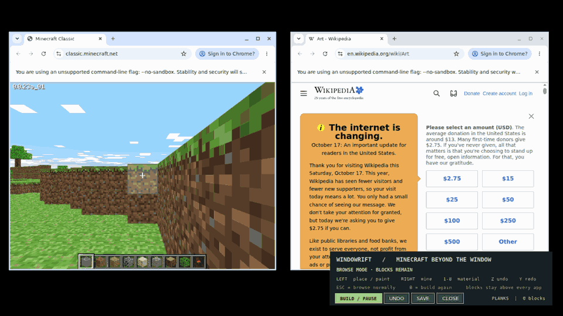

# Minecraft beyond the window: native desktop building

This is **not an HTML Minecraft clone**, not a Minecraft-themed site, and not
an extension that adds blocks only to pages prepared for WindowRift.

WindowRift samples the hotbar of a **real, visibly running Minecraft Classic**
window (official free WebGL version), then places an independently shaped,
input-transparent block layer at **desktop screen coordinates**. Place blocks
across an unrelated page, above the browser's native address bar, on a terminal,
or directly on the desktop. All visible applications remain running normally.

The Minecraft application and any websites are **not modified**. These are
visual desktop blocks. An opt-in build mode grabs the X11 mouse and temporarily
prevents underlying applications receiving its clicks. Esc releases the grab;
the blocks stay. Website navigation and refresh do not change block positions.

## Play it

Requirements: Linux with an actual **X11** session, Chrome/Chromium, Python
3.10+, Tk, `wmctrl` or `xprop`, and a working WebGL browser.

```bash
sudo apt install python3-tk wmctrl x11-utils
python3 -m venv .venv
source .venv/bin/activate
pip install -e .

# First, open Minecraft Classic (and allow its world to finish generating):
# https://classic.minecraft.net/
# Next, open ANY unrelated website in another window (Wikipedia, GitHub, etc.)
python examples/minecraft_desktop_builder.py
```

The first builder screen captures your **own** visible game icons. If the game
hotbar is hidden, a different window covers it, or the browser's UI scaling
is unusual, the program stops rather than silently displaying an unrelated
screenshot. `--crop-adjust dx,dy` shifts the extraction positions.

| Action | Control |
|---|---|
| Place a block anywhere, even over Chrome's own toolbar | Left mouse button |
| Draw a bridge or wall rapidly | Hold left mouse button and drag |
| Remove a block anywhere | Right mouse button (drag to erase multiple) |
| Switch Minecraft hotbar material | Number keys `1`–`8` or mouse wheel |
| Undo / redo | `Z` / `Y` |
| Stop capturing clicks and use websites normally | `Esc` |
| Resume desktop building | Select the controller and press `B` |
| Save to local file | `P` or `Save` button |
| Quit | `Q` or `Close` |

Only the pointer is grabbed during Build Mode. No global keyboard logger is
installed, and input returns to normal immediately after Esc or closing the
window. If the program is terminated, the X11 server releases its client grab.

By default the native desktop world is stored in
`~/.local/share/windowrift/desktop-world.json`. The file contains only screen
coordinates and material names, **no Minecraft files or copyrighted textures**.
The pixels for each icon are sampled again from your running Minecraft the
next time you launch. To keep separate worlds, set `--world-file PATH`.

Blocks are snapped on a screen-space grid and do not become objects in the
original Minecraft world. They also do not become elements in your website's
DOM, so unrelated pages need **no permissions, no script injection, no code
changes, and no browser extension**. The desktop overlay is independent of the
browser and survives page reloads or navigation.

## Real-game, real-website integration proof



[Actual Wikipedia screenshot](media/minecraft-anywhere-wikipedia.png) · [After navigation to example.com](media/minecraft-anywhere-example-com.png). The 90 source frames are successive screenshots from the original X11 desktop; the README animation only downsamples resolution, frame count and palette for size. This is *not* a synthetic recreation or an HTML overlay.

The CI workflow `Minecraft outside any website` opens two real Chromium windows
on X11. The source loads the official Minecraft Classic world; the destination
loads a public, Minecraft-unrelated Wikipedia article. CI uses actual X11
mouse clicks and drags to place, stack and mine several material types **above
Wikipedia and Chrome's own toolbar**, then navigates the same Chrome window to
`example.com`. It checks that all placed blocks remain in the independent
world file, that the web page has no injected WindowRift DOM nodes, and that
screen captures and a GIF came from the running X11 desktop.

All game imagery in CI is from the runtime official site; no Minecraft client,
texture archive, or copied assets are checked into the repository. Do not claim
that the original Minecraft world was edited or that the game engine granted
WindowRift access to its internal entities.

## Honest limitations

- Only the new native desktop building workflow is tested on **Linux X11**;
  Wayland denies the XGrabPointer approach, and the Windows counterpart is not
  implemented in this version.
- This is a **visual game-window extension**, not source-level or memory-level
  transplantation of the original game's blocks.
- The source hotbar crop is calibrated for a visible 760×680 Minecraft Classic
  window at 100% UI scaling, not all Minecraft Java/Bedrock clients.
- A desktop-anchored block intentionally stays at a screen coordinate even if
  another application window is moved behind it. It does not scroll with the
  web page, because it is not inside that page.
